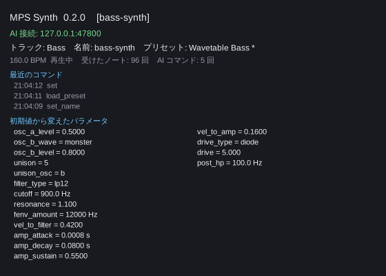

# MPS Synth / MPS FX

テックコア、ハイテクコア、フューチャーコアなど、ハードコア系の曲の音作りに使う VST3 プラグインです。
**AI(Claude など)が GUI を触らずに外部から操作できる**のが特長で、DAW に挿したトラックを名前で選び、
プリセットの読み込み、音色の調整、試聴、WAV の書き出しを AI に任せられます。

- **MPS Synth**(音源): キック、スネア、クラップ、ハット、クラッシュ、メインベース、のこぎり+ウェーブテーブルの歪みベース、アシッド、
  スーパーソウ、wub コード、矩形波プラック、PWM リード、FM ベル、3 フォルマントの母音っぽい音、ライザーなど 36 のプリセット。
  2 つのオシレーター、ユニゾン、キックのピッチ・エンベロープ、フィルター(LP/HP/BP/フォルマント)、Phaser・オールパス(位相の分散)・歪みを内蔵。
- **MPS FX**(エフェクト): サイドチェイン(曲のテンポか MIDI ノートで)、テープストップ、Phaser、オールパス、歪み、
  ステレオ幅 + Bass Mono。プリセットは 6 つ。
- 対応: macOS(**Apple Silicon と Intel のユニバーサル**、10.15 以降)、Windows 10/11(x64)、Linux(x64)。VST3 に対応した DAW。



画面は状態を見るためのもので、操作はしません。トラック名、プリセット名(手で変えると末尾に `*`)、AI から届いた最近のコマンド、
初期値から変えたパラメータが出ます。音色は DAW の汎用パラメータ画面やオートメーションでも変えられます。

## インストール
1. [Releases](https://github.com/maniax-jp/mps-synth-plugin/releases) から自分の OS の zip
   (`MPS-macos-universal.zip` / `MPS-windows-x64.zip` / `MPS-linux-x64.zip`)をダウンロードして展開します。
2. `MPS.vst3` を VST3 フォルダに入れます。
   - macOS: `~/Library/Audio/Plug-Ins/VST3/`
   - Windows: `C:\Program Files\Common Files\VST3\`
   - Linux: `~/.vst3/`
3. **macOS のみ**: ダウンロードしたプラグインは読み込みを止められるので、ターミナルで次を実行します。
   ```bash
   xattr -dr com.apple.quarantine ~/Library/Audio/Plug-Ins/VST3/MPS.vst3
   ```
4. DAW でプラグインを再スキャンします。音源プラグインとして MPS Synth が、FX プラグインとして MPS FX が読み込まれます。

zip にはほかに AI 用のスキル `mps-synth-plugin-skill.zip` が入っています。

## AI から操作する(Claude 用スキル)
Claude に操作方法を教えるスキル `mps-synth-plugin` を用意しています。どれか 1 つの方法で入れてください。

- **Claude Code(プラグインとして)**:
  ```
  /plugin marketplace add maniax-jp/mps-synth-plugin
  /plugin install mps-synth@maniax-jp-mps-synth-plugin
  ```
  (Claude Code 2.1.275 以降なら `/plugin install mps-synth --marketplace maniax-jp/mps-synth-plugin` の 1 行でも入ります)
- **Claude Code(手で)**: `mps-synth-plugin-skill.zip` を展開し、`mps-synth-plugin` フォルダを `~/.claude/skills/` に置きます。
- **claude.ai**: 設定の「Skills」で `mps-synth-plugin-skill.zip` をそのままアップロードします。

スキルの中の操作スクリプトは Python 3 で動くので、DAW と同じマシンに Python 3 が必要です。
使い方の例(Claude に頼むとこの操作をしてくれます):
```bash
python3 mps_ctl.py list                                  # 47800  MPS Synth  track='Bass'
python3 mps_ctl.py --track Bass load "Wavetable Bass"
python3 mps_ctl.py --track Bass set cutoff=900 drive=5
python3 mps_ctl.py --track Bass play 41 --duration 0.3
```
DAW のトラックに名前を付けておくと、AI が「Bass トラックのシンセ」のように選べます。
同じトラックに MPS FX を 2 つ以上挿すときは、それぞれに名前(例: `pump`、`tapestop`)を付けると、名前で呼び分けられます。
名前はプロジェクトと一緒に保存され、プラグインの画面にも表示されます。

## プライバシーと安全
- 各インスタンスは自分のパソコンの中だけ(`127.0.0.1`)で操作を待ち受けます。ほかのパソコンやインターネットからは届きません。
- 起動中のインスタンスの一覧(ポート番号とトラック名)を `~/.mps-plugins/instances/`(Windows は `%LOCALAPPDATA%\mps-plugins\instances`)に置きます。
  DAW を普通に終了すると消えます(強制終了で残ったものは、次に AI が一覧を取るときに片付けられます)。
- 外部からの操作を止めたいときは、DAW を起動する前に環境変数 `MPS_CTL_DISABLE=1` を設定してください。

## プリセットとパラメータ
- プリセット一覧: [スキルの references/presets.md](plugin/skills/mps-synth-plugin/references/presets.md)
- パラメータ一覧: [スキルの references/parameters.md](plugin/skills/mps-synth-plugin/references/parameters.md)

## うまく動かないとき
- **DAW に出てこない**(macOS): 上の `xattr` を実行したか確かめ、それでもだめなら `codesign --force --deep --sign - MPS.vst3` を実行して再スキャンします。
- **AI から見つからない**: プラグインの画面の「AI 接続」の行を見てください。`無効` なら環境変数 `MPS_CTL_DISABLE` を外して DAW を起動し直します。
- **テープストップが 2 回目に動かない**: `Tape Stop` は off → on に変わった瞬間に始まります。一度 off に戻してください。

ソースからのビルドや仕組みは [DEVELOPMENT.md](DEVELOPMENT.md) を見てください。

## ライセンス
[MIT License](LICENSE)。
VST は Steinberg Media Technologies GmbH の商標です。
